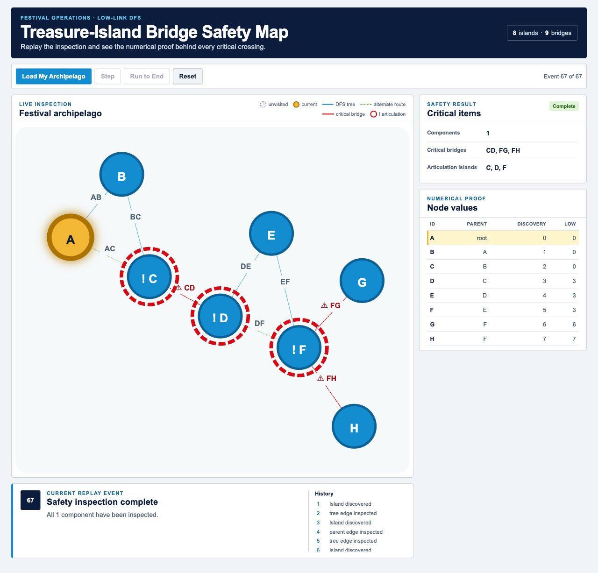

# Treasure-Island Bridge Safety Map

A small React + TypeScript application that explains Tarjan-style low-link DFS by replaying a festival footbridge safety inspection.

## Run locally

Requires Node.js 20 or newer and pnpm.

```bash
pnpm install
pnpm start
```

Open the local URL printed by Vite, then:

1. select **Load My Archipelago**;
2. use **Step** to inspect one deterministic event at a time;
3. use **Run to End** to finish the same event sequence;
4. use **Reset** to restore the untouched candidate graph.

## Verify

```bash
pnpm test
pnpm typecheck
pnpm build
```

## Architecture

- `src/domain/`: pure validation, adjacency, low-link DFS, event generation, and replay projection;
- `src/data/`: candidate graph only; expected answers are never imported by runtime code;
- `src/hooks/`: replay lifecycle for Load, Step, Run, and Reset;
- `src/features/`: small presentation components for controls, SVG map, event, summary, and table;
- `docs/`: oracle, event contract, design rationale, implementation plan, AI interaction record, and test evidence.

The application never reads expected bridge, articulation, discovery, or low-link values as input. It calculates them from the graph.

## Algorithm summary

For each component root and neighbour in ascending node-ID order:

- discovery sets `discovery[u] = low[u] = clock`;
- a completed child propagates `low[u] = min(low[u], low[v])`;
- an already visited non-parent neighbour propagates its discovery time;
- tree edge `(u,v)` is a bridge when `low[v] > discovery[u]`;
- non-root `u` is an articulation point when `low[v] >= discovery[u]`;
- a root is an articulation point only with at least two DFS-tree children.

The complete event history is immutable. The visible replay is derived from the prefix ending at the selected event, which guarantees Step and Run to End use identical logic.

## Main demonstration result

- Discovery order: `A, B, C, D, E, F, G, H`
- Components: `1`
- Critical bridge IDs: `CD, FG, FH`
- Articulation island IDs: `C, D, F`


# code_with_cisco
